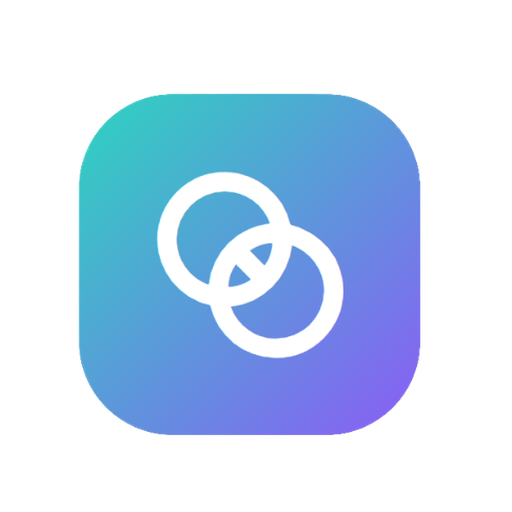
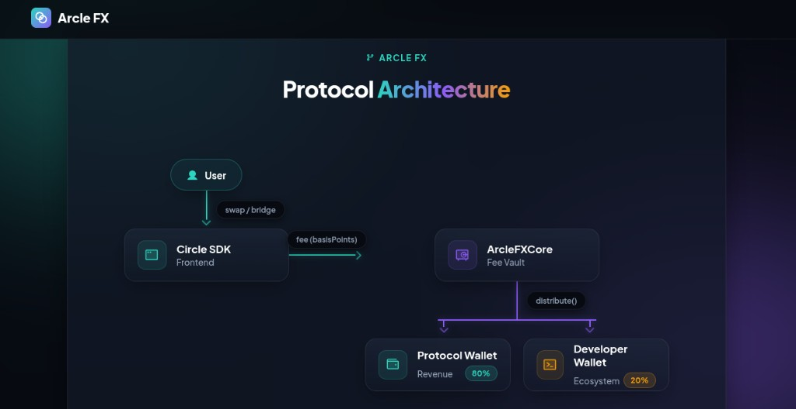

<h1>Arcle FX</h1>

<strong>Non-Custodial Cross-Chain FX Protocol — Built on ARC Network</strong>

  &nbsp;
  &nbsp;
  

  Arcle FX enables fast, secure bridging and swapping of stablecoins —&nbsp;
  <strong>USDC</strong>, <strong>EURC</strong>, and <strong>cirBTC</strong> — across&nbsp;
  <strong>Ethereum</strong>, <strong>Arbitrum</strong>, <strong>Base</strong>, and <strong>ARC Network</strong>&nbsp;
  using Circle's CCTP v2 infrastructure. No wrapping. No custody. Just native assets.

<a href="https://arclefx.com"><strong>🚀 Live App</strong></a> &nbsp;·&nbsp;
<a href="https://arclefx.com/docs"><strong>📖 Docs</strong></a> &nbsp;·&nbsp;
<a href="https://arclefx.com/docs/why-arcle-fx"><strong>⚡ Why Arcle FX?</strong></a> &nbsp;·&nbsp;
<a href="mailto:admin@arclefx.com"><strong>✉️ Contact</strong></a>

---

## 🌟 Why Arcle FX?

> Most bridges wrap your tokens. Arcle FX doesn't. Every transfer uses Circle's burn-and-mint mechanism — you send **native USDC** on one chain and receive **native USDC** on the destination. Always.

<table>
  <tr>
    <td align="center" width="25%">
      <h3>⛓️</h3>
      <strong>Bridge</strong> 
      Transfer USDC, EURC or cirBTC across 4 chains via Express (~20s) or Economy (free, ~20min)
    </td>
    <td align="center" width="25%">
      <h3>🔄</h3>
      <strong>Swap</strong> 
      Same-chain and cross-chain stablecoin swaps powered by CCTP routing in one transaction
    </td>
    <td align="center" width="25%">
      <h3>💰</h3>
      <strong>Unified Balance</strong> 
      Aggregate your USDC across all 4 chains and send from one total in a single click
    </td>
    <td align="center" width="25%">
      <h3>⚡</h3>
      <strong>Send on ARC</strong> 
      Sub-second finality, gas paid in USDC — no ETH required on ARC Network
    </td>
  </tr>
</table>

---

## 🌐 Supported Networks

<table>
  <tr>
    <th>Network</th>
    <th>Chain ID</th>
    <th>CCTP Domain</th>
    <th>USDC</th>
    <th>EURC</th>
    <th>cirBTC</th>
    <th>Express Bridge</th>
  </tr>
  <tr>
    <td> Ethereum Mainnet</td>
    <td><code>1</code></td>
    <td><code>0</code></td>
    <td>✅</td>
    <td>✅</td>
    <td>✅</td>
    <td>✅</td>
  </tr>
  <tr>
    <td> Arbitrum One</td>
    <td><code>42161</code></td>
    <td><code>3</code></td>
    <td>✅</td>
    <td>✅</td>
    <td>—</td>
    <td>✅</td>
  </tr>
  <tr>
    <td> Base</td>
    <td><code>8453</code></td>
    <td><code>6</code></td>
    <td>✅</td>
    <td>✅</td>
    <td>—</td>
    <td>✅</td>
  </tr>
  <tr>
    <td> ARC Network</td>
    <td><code>5042</code></td>
    <td><code>26</code></td>
    <td>✅</td>
    <td>✅</td>
    <td>✅</td>
    <td>✅</td>
  </tr>
</table>

> All routes are **bidirectional**. Any network can send to any other network.

---

## ⚡ Bridge Modes

<table>
  <tr>
    <th>Mode</th>
    <th>Settlement Time</th>
    <th>Fee</th>
    <th>Mechanism</th>
    <th>Best For</th>
  </tr>
  <tr>
    <td>🚀 <strong>Express</strong></td>
    <td><strong>~20 seconds</strong></td>
    <td>Variable relay fee</td>
    <td>CCTP Fast Burn (v2)</td>
    <td>Time-sensitive transfers</td>
  </tr>
  <tr>
    <td>🌿 <strong>Economy</strong></td>
    <td>~20 minutes</td>
    <td><strong>Free</strong></td>
    <td>CCTP Standard</td>
    <td>Large transfers, cost-sensitive</td>
  </tr>
</table>

---

## 📊 Fee Structure

| Action | Fee | Notes |
|---|---|---|
| 🚀 Bridge — Express | Variable relay fee | Calculated by Circle CCTP relay at time of transfer |
| 🌿 Bridge — Economy | **Free** | Standard CCTP attestation, no relay required |
| 🔄 Swap | **0.30%** | Liquidity Provider fee |
| 💰 Unified Balance Send | **0.10%** | Protocol fee |

> Express relay fees are determined by Circle's CCTP relay and vary based on destination chain gas costs. Fees are always shown before confirmation. See [Fee Structure docs](https://arclefx.com/docs/bridge#fees) for details.

---

## 🔒 Security

| Property | Detail |
|---|---|
| **Non-Custodial** | Arcle FX never holds or controls user funds at any point |
| **Native Assets Only** | No synthetic or wrapped tokens — always native USDC / EURC |
| **Circle CCTP Backed** | Built on the same infrastructure powering institutional USDC transfers |
| **On-Chain Verification** | Every burn is attested by Circle and verified on the destination chain |
| **Wallet-Signed** | All transactions require explicit wallet signature — no approvals stored |

---

## 🏗️ Protocol Architecture

 

  

 

> User initiates a swap or bridge → Circle SDK collects the fee in basis points → ArcleFXCore (Fee Vault) distributes it: **80% Protocol Wallet** (Revenue) · **20% Developer Wallet** (Ecosystem).

---

## 📖 Documentation

Full documentation is available at [arclefx.com/docs](https://arclefx.com/docs):

<table>
  <tr>
    <th>Section</th>
    <th>Pages</th>
  </tr>
  <tr>
    <td><strong>Overview</strong></td>
    <td>Introduction · Why Arcle FX? · Supported Networks</td>
  </tr>
  <tr>
    <td><strong>Core Features</strong></td>
    <td>Bridge · Swap · Unified Balance · Send on ARC Network</td>
  </tr>
  <tr>
    <td><strong>Developer Tools</strong></td>
    <td>App Kits SDK · CCTP & Gateway · Smart Contracts · Token Addresses</td>
  </tr>
  <tr>
    <td><strong>User Guide</strong></td>
    <td>Connect Wallet · Transaction Settings · Circle Paymaster</td>
  </tr>
  <tr>
    <td><strong>Resources</strong></td>
    <td>Block Explorer</td>
  </tr>
</table>

---

## 📄 License

This project is licensed under the **MIT License** — see the [LICENSE](LICENSE) file for details.

---

Built on <a href="https://arc.io">ARC Network</a> · Powered by <a href="https://www.circle.com/cross-chain-transfer-protocol">Circle CCTP v2</a>

  <a href="https://arclefx.com">Live App</a> ·
  <a href="https://arclefx.com/docs">Documentation</a> ·
  <a href="https://www.circle.com">Circle</a> ·
  <a href="mailto:admin@arclefx.com">Contact</a>

